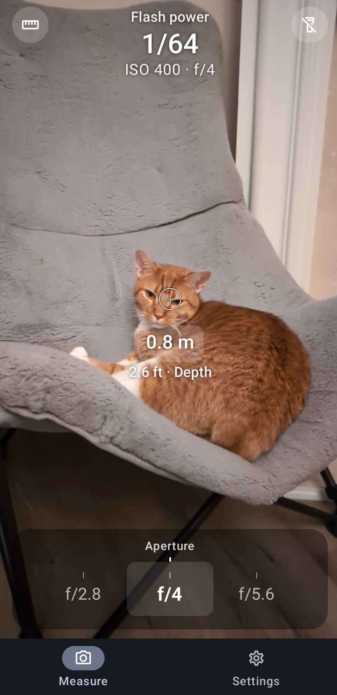
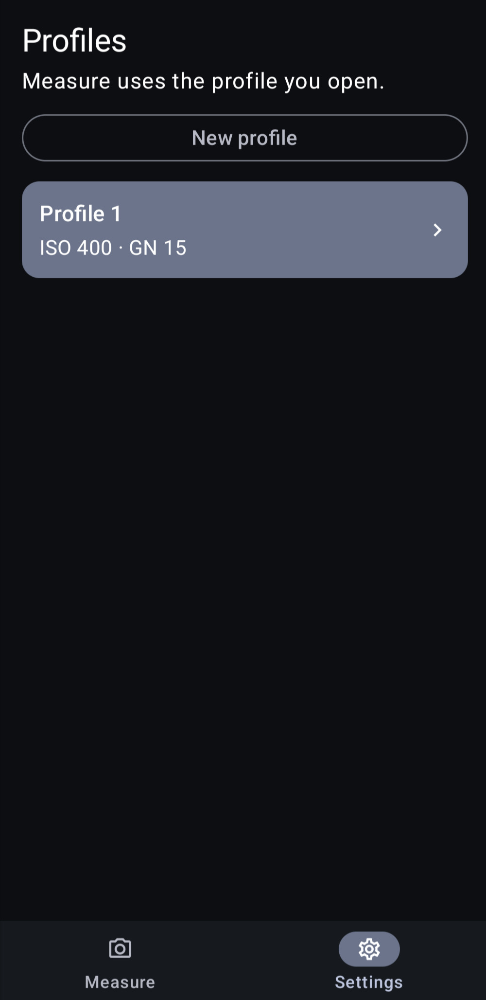
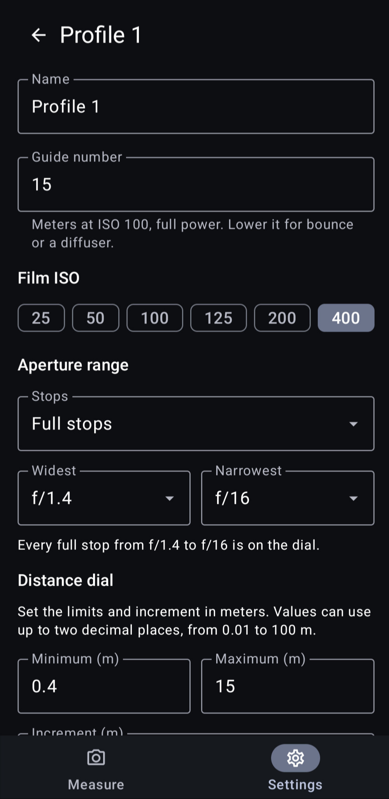

# FlashCal

> **Note:** This app was made possible with the help of AI coding tools (Claude and Codex). Review the code and test the results yourself before relying on it, and use it at your own caution.

**A manual flash exposure calculator for Android.**

FlashCal helps you choose flash power from subject distance, aperture, ISO, and your flash’s guide number. Use it with film or digital cameras and manual flashes that match the app’s supported settings. Save profiles for different setups, measure distance with your phone, or enter a fixed distance to plan an exposure.

The phone does not fire the flash or communicate with your camera. You apply the suggested settings to your equipment yourself.

## Screenshots

Captured from FlashCal on a Pixel 8 Pro.

| Live camera measurement | Saved profiles | Profile settings |
| --- | --- | --- |
|  |  |  |

## Features

- **Live distance measurement:** aim the center target at your subject on a phone with supported ARCore measurement capabilities.
- **Fixed-distance calculation:** use the distance dial without a camera reading or camera permission.
- **Reusable profiles:** save a guide number, ISO, aperture range and spacing, and distance-dial settings for each setup.
- **Aperture controls:** choose full-, half-, or third-stop spacing, with a custom f-number option.
- **Manual power suggestions:** calculate the nearest supported power setting from full power through 1/64.
- **Practical controls:** hold a distance reading, restart measuring, choose meters or feet for the whole app, and use the phone’s flashlight in dim surroundings.

## Getting started

1. Complete the first-launch guide. Camera permission is optional if you use fixed distance.
2. Pick meters or feet at the top of the Settings page; this applies to every profile. Then create or edit a profile. Enter your flash’s **full-power guide number at ISO 100, in that unit**, select your film or camera ISO, and set the aperture range to suit your lens.
3. Hold the phone near the flash and aim the center target at the subject, or switch to fixed distance and select the flash-to-subject distance.
4. Choose an aperture with the horizontal dial. FlashCal shows the suggested manual flash power.
5. Set that aperture and power on your equipment, use a shutter speed compatible with your camera’s flash sync, and take a test shot.

The initial guide number is 15. Replace it with the value for your flash and its current zoom or coverage setting. If your flash lists guide numbers in feet, switch the unit to feet and enter the value as printed. Switching units converts the guide number and distance dial of every profile, rounded to one decimal each time.

## Profiles and supported settings

Profiles let you switch between flashes, lenses, ISO settings, or shooting setups without re-entering everything.

| Setting | Supported values                                               |
| --- |----------------------------------------------------------------|
| Base guide number | 1–80 m (about 3–262 ft) at ISO 100 and full power              |
| ISO | 25, 50, 100, 125, 200, 400, 800, 1600, 3200                    |
| Flash power suggestions | Full, 1/2, 1/4, 1/8, 1/16, 1/32, 1/64                          |
| Aperture spacing | Full, half, or third stops within a saved range                |
| Custom aperture | f/0.7–f/128                                                    |
| Fixed-distance scale | Configurable minimum, maximum, and increment within 0.01–100 m |

The default distance dial spans 1–10 m in 0.5 m steps. Readings are shown in the chosen unit, with the other unit alongside; calculations use meters internally. Aperture ranges include all supported stops between their endpoints.

Check that your flash offers the suggested power setting. The app uses the power steps listed above; it does not discover your equipment’s capabilities.

## How the calculation works

```text
effective GN = base GN × √(ISO / 100) × √(power fraction)
f-number = effective GN / distance in meters
power fraction = (f-number × distance / (base GN × √(ISO / 100)))²
```

For example, with a base guide number of 20 at ISO 100, a subject 2.5 m away needs f/8 at full power. Choosing f/4 at the same distance calls for 1/4 power.

FlashCal selects the nearest supported power step and reports when the required power falls outside the supported range. Shutter speed is not part of the guide-number calculation; set a suitable flash-sync speed on your camera.

## Measuring distance

The center circle and cross identify the distance sample. FlashCal first uses ARCore’s raw depth around that point, keeping only pixels ARCore is confident about, and falls back to its smoothed depth. When depth is unavailable, it can use a detected surface or a rough feature-point estimate. The caption under the reading shows which source is in use (Depth, Surface, or Estimate). The shown value is the median of the last fraction of a second of readings, so single-frame spikes are ignored. Live measurement depends on the phone, ARCore support, and the scene; fixed distance remains available when measurement is unavailable.

Hold the phone near the flash so the reading approximates the **flash-to-subject distance**. A reading from elsewhere in the room measures the wrong light path. At close distances, small position differences matter more, so treat the result as a starting point and bracket if needed.

- Tap the distance reading to hold or release a measurement. A held reading turns into a bright white pill labeled “Held”.
- Use the refresh button under the flashlight button to clear the reading and restart AR tracking, for example after moving to a new spot. The preview blinks for about a second while the session restarts.
- Use the top-left ruler button to toggle fixed distance. Its dial follows the active profile’s limits and increment.
- Use the top-right flashlight button for the phone’s own light. Switching it on can briefly affect measurement while camera exposure settles.

Autofocus runs continuously and separately from distance measurement. Green rectangles show autofocus regions reported by the camera; they do not mark the distance sample or everything that is optically sharp.

### Measurement limitations

Phone depth is an estimate, not a rangefinder. Check important shots against a known distance or with a test exposure.

- **Best range is about 0.5–5 m.** On phones without a depth sensor, ARCore estimates depth from camera movement, and the error grows quickly with distance. Beyond roughly 5–8 m, readings can be off by a meter or more.
- **Depth needs a little movement.** Move the phone slightly side to side before reading, especially after aiming at a new subject. A phone held perfectly still sees no parallax and produces little new depth.
- **Some scenes are hard to measure.** Dim rooms, blank walls, glass, mirrors, glossy or very dark surfaces, and fast motion reduce accuracy or stop tracking. The torch helps in the dark but can briefly disturb the reading while exposure settles.
- **Edges blend near and far.** Aiming at the edge of a subject, or at a thin subject in front of a distant background, can give a value between the two. Aim at the middle of the subject.
- **Not every phone supports ARCore depth.** Without it, only detected surfaces and feature points are available. Readings labeled “Estimate” are rough.
- **Tracking can get lost after moving.** Walking to a new spot, covering the camera, or moving quickly can make ARCore lose its place. If tracking stays lost for about 4 seconds, FlashCal restarts the AR session automatically. It does not do this in low light or when the scene lacks detail, because a new session would not track there either. Use the refresh button to restart sooner.
- **Readings are rounded to 0.1 m** before they are shown and used in the calculation, even when feet are selected.
- **Autofocus can affect tracking slightly.** The app keeps autofocus on for the focus-area overlay; ARCore tracks a little more steadily with fixed focus.

## Exposure considerations

Guide numbers are a starting point for direct manual flash. Bounce, diffusers, flash zoom, modifiers, and the surroundings affect how much light reaches the subject. Use a tested effective guide number for your setup and check the result with a test exposure or flash meter.

FlashCal does not provide TTL metering or model high-speed sync. Follow your camera and flash instructions for triggering and sync speed. When balancing flash with ambient light, evaluate the ambient exposure separately.
